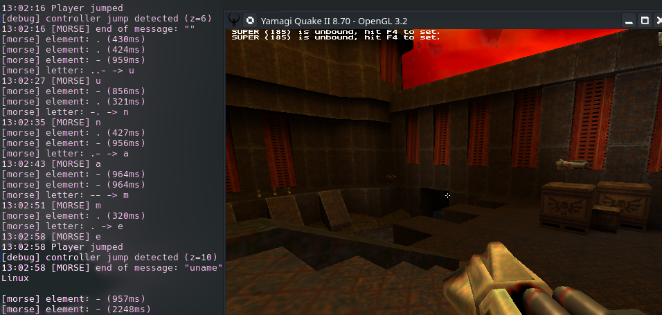

# phobophobia



PhobosController (ФобосКонтролл) is a unique messaging platform that uses multiple encoding schemes to support command-and-control communications with remote hosts over Quake 2's GPL netcode.


# Compile
go build -o phobosbuilda cmd/phobosbuilda/main.go


# Configure

You're gonna need to specify a server manually with the current build. When I'm feeling fancy later I'll implement some kind of rendezvous system :-) but for now just specify an IP address of any Quake 2 server you desire.

```
#phobos.cfg - Phobos client build configuration (phobosbuilda reads this and embeds its config into a portable Phobos binary).

# Specify the name of the Phobos client when it joins a Quake 2 server.
PhobosName:         Phobos

# Specify the name of the player that Phobos should look for to receive encoded communications from. Change "Player" to whatever you set.
ControllerName:     Player

# The auth handshake you perform in-game: 3 rocket shots, 1 jump, 2 rocket shots.
ControllerSequence: ROCKET3,JUMP,ROCKET2

# 1 = decode movement as Morse code. #2 = decode as Base4 (NOT IMPLEMENTED YET)
CmdMethod:          1

# Specify Quake 2 server to look for our Controller host:port; 27910 is the Quake 2 default.
Server:             127.0.0.1:27910

# Print live decode output (elements, letters, finished words).
Verbose:            1
```

# Build a Phobos client binary with PhobosBuilda


`./phobosbuilda cmd/phobos/phobos.cfg -o phobos`


# Execute the Phobos client binary on a system you wish to communicate with

`./phobos`

Никто не умеет перепрыгивать через дельфинов, одновременно чистя лук, лучше, чем я. все...
